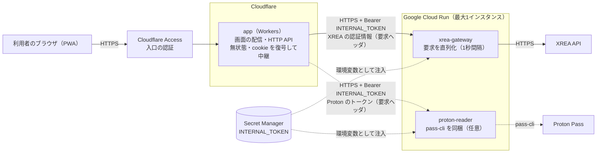
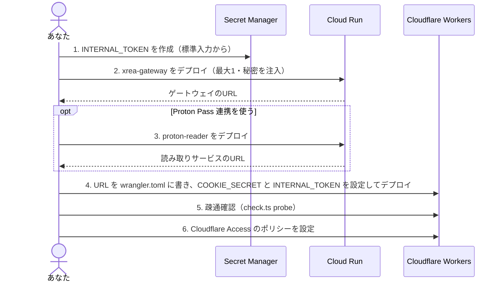

# クラウドへの配備

アプリ（`app`）を Cloudflare Workers の無料枠へ、XREAゲートウェイと Proton Pass 読み取りサービスをコンテナ基盤へ配備する手順です。コンテナ基盤は、条件を満たせばどれでも使えます。この文書では具体例として Google Cloud Run の手順を示します。配備はすべて手動で実行し、自動の配備の定義は置きません。

## 構成



実線は必須の経路、点線は任意（Proton Pass 連携）または設定の経路です。

| コンポーネント  | 動かす場所         | 状態                                                           | 備考                                                 |
| --------------- | ------------------ | -------------------------------------------------------------- | ---------------------------------------------------- |
| `app`           | Cloudflare Workers | なし。認証情報は暗号化した cookie に入り、サーバには保存しない | 秘密は `COOKIE_SECRET` と `INTERNAL_TOKEN`           |
| `xrea-gateway`  | コンテナ           | なし                                                           | **最大1インスタンス**。XREAの1秒間隔の制限を守るため |
| `proton-reader` | コンテナ（任意）   | セッションのみ（一時領域でよい）                               | 使わなければ配備せず、`PROTON_READER_URL` を空にする |

通信に載るのは、認証情報（要求ヘッダ）と、アドレスとエントリ名の対応表だけです。Proton Pass のパスワードは応答にもログにも出ません。

### 配備の順序

コンテナのURLは配備後に決まるため、コンテナ → Workers の順に進めます。



## 1. 事前に決めるもの

| 項目                  | 内容                                                                                     |
| --------------------- | ---------------------------------------------------------------------------------------- |
| COOKIE_SECRET         | 認証情報を暗号化する鍵の元。32文字以上。Workers だけが持つ                               |
| INTERNAL_TOKEN        | Workers とコンテナ間の共有シークレット。32文字以上。ゲートウェイと読み取りサービスで共通 |
| ゲートウェイのURL     | 手順2で公開するHTTPSのURL                                                                |
| 読み取りサービスのURL | 手順3で公開するHTTPSのURL。Proton Pass 連携を使わないなら不要                            |

秘匿値（COOKIE_SECRET と INTERNAL_TOKEN）は、リポジトリ・チャット・シェルの履歴・ログに残さないでください。以降の手順は、値をコマンドの引数に書かず、標準入力か対話入力で渡す形にしています。

### コンテナ基盤に求める条件（基盤に依存しない）

| 条件               | ゲートウェイ                                    | 読み取りサービス                               |
| ------------------ | ----------------------------------------------- | ---------------------------------------------- |
| イメージ           | `--target app`（起動コマンドだけを変える）      | `--target reader`                              |
| コマンド           | `node /app/dist/gateway/main.js`                | 既定（`node /app/dist/reader/main.js`）        |
| 環境変数           | `INTERNAL_TOKEN`。`PORT` は基盤が与える値を使う | 同左（`SESSION_DIR` は既定のままでよい）       |
| 最大インスタンス数 | **1**（複数だと1秒間隔の制限を守れない）        | 1                                              |
| 公開               | HTTPS（Workers から呼び出せること）             | HTTPS                                          |
| 永続ボリューム     | 不要                                            | 不要（失われても次の要求で自動的に再ログイン） |
| 死活確認           | `GET /health` が 200                            | `GET /health` が 200                           |

XREAの接続元IP制限は設定しないでください。固定のIPを持たない基盤でも動かせます。共有シークレットを知らない呼び出し元は 401 で拒否されます。

## 2. Google Cloud Run の手順（ゲートウェイ）

### 2.1 準備

```sh
export PROJECT_ID=<プロジェクトID>
export REGION=asia-northeast1
gcloud config set project "$PROJECT_ID"

gcloud services enable run.googleapis.com artifactregistry.googleapis.com secretmanager.googleapis.com

gcloud artifacts repositories create xrea --repository-format=docker --location="$REGION"
gcloud auth configure-docker "$REGION-docker.pkg.dev"
```

共有シークレットを Secret Manager に作ります。値は標準入力で渡すため、画面にもシェルの履歴にも残りません。

```sh
openssl rand -base64 48 | tr -d '\n' | gcloud secrets create xrea-internal-token --data-file=-

# Cloud Run の実行用サービスアカウントに読み取りを許可する（既定はCompute Engineの既定アカウント）
PROJECT_NUMBER=$(gcloud projects describe "$PROJECT_ID" --format='value(projectNumber)')
gcloud secrets add-iam-policy-binding xrea-internal-token \
  --member="serviceAccount:${PROJECT_NUMBER}-compute@developer.gserviceaccount.com" \
  --role=roles/secretmanager.secretAccessor
```

Workers にも同じ値を渡す必要があります。手順4で、Secret Manager から取り出して `wrangler secret put` へ標準入力で渡します。

### 2.2 ビルドとデプロイ

Cloud Run は amd64 で動くため、Apple Silicon などでは `--platform linux/amd64` を付けます。

```sh
IMAGE_APP="$REGION-docker.pkg.dev/$PROJECT_ID/xrea/app:v1"
docker build --platform linux/amd64 --target app -t "$IMAGE_APP" .
docker push "$IMAGE_APP"

gcloud run deploy xrea-gateway \
  --image "$IMAGE_APP" --region "$REGION" \
  --command node --args /app/dist/gateway/main.js \
  --max-instances 1 --min-instances 0 \
  --allow-unauthenticated \
  --set-secrets INTERNAL_TOKEN=xrea-internal-token:latest
```

| 指定                      | 理由                                                                                                            |
| ------------------------- | --------------------------------------------------------------------------------------------------------------- |
| `--max-instances 1`       | XREAへの要求を1つのプロセスで直列化するため。同時実行数（既定80）は、プロセス内の直列化があるので変えなくてよい |
| `--min-instances 0`       | 常駐させない。アイドル後の最初の要求だけ、起動の待ちが入る                                                      |
| `--allow-unauthenticated` | Workers は Google の ID トークンを持たないため。呼び出しの認可は `INTERNAL_TOKEN`（401 で拒否）が担う           |
| `--set-secrets`           | 秘匿値をデプロイの定義に書かず、Secret Manager から環境変数として注入する                                       |
| `PORT` を指定しない       | Cloud Run が設定する予約の変数。アプリはその値で待ち受ける                                                      |

```sh
export GATEWAY_URL=$(gcloud run services describe xrea-gateway --region "$REGION" --format='value(status.url)')
echo "$GATEWAY_URL"
```

## 3. Google Cloud Run の手順（Proton Pass 読み取りサービス・任意）

使わない場合はこの手順を飛ばし、手順4の `PROTON_READER_URL` を空のままにします。Proton Pass 連携は無効になり、読み取りサービスの呼び出しも発生しません。

```sh
IMAGE_READER="$REGION-docker.pkg.dev/$PROJECT_ID/xrea/reader:v1"
docker build --platform linux/amd64 --target reader -t "$IMAGE_READER" .
docker push "$IMAGE_READER"

gcloud run deploy proton-reader \
  --image "$IMAGE_READER" --region "$REGION" \
  --max-instances 1 --min-instances 0 \
  --allow-unauthenticated \
  --set-secrets INTERNAL_TOKEN=xrea-internal-token:latest

export READER_URL=$(gcloud run services describe proton-reader --region "$REGION" --format='value(status.url)')
echo "$READER_URL"
```

セッションの保存先（`SESSION_DIR`）は既定のままで構いません。Cloud Run のファイルシステムは一時領域で、再起動で失われても、次の要求で読み取りサービスが自動的に再ログインします。

## 4. Cloudflare Workers の手順（app）

```sh
npm ci
npm run build:worker && npm run build:web
```

`wrangler.toml` の `[vars]` に、手順2・3で得たURLを書きます（URLは秘匿値ではないため定義に置きます）。

```toml
[vars]
XREA_GATEWAY_URL = "https://xrea-gateway-xxxxxxxx-an.a.run.app"
PROTON_READER_URL = ""   # 使うときは手順3のURL。使わないなら空のまま
```

秘密を設定します。`INTERNAL_TOKEN` は Secret Manager から取り出して標準入力で渡すため、画面に出ません。`COOKIE_SECRET` は新しく作って渡します（Workers だけが持ち、ほかのコンポーネントとは共有しません）。

```sh
gcloud secrets versions access latest --secret=xrea-internal-token | npx wrangler secret put INTERNAL_TOKEN
openssl rand -base64 48 | tr -d '\n' | npx wrangler secret put COOKIE_SECRET
npx wrangler deploy
```

`COOKIE_SECRET` を変更すると、登録済みの認証情報はすべて復号できなくなり、利用者は再登録が必要になります。値を控えるか、変更しない運用にしてください。

Workers は `XREA_GATEWAY_URL` と `PROTON_READER_URL` に https 以外を受け付けません（http だと 500 になり、ログに変数名が出ます）。Workers は SQLite 方式の認証情報の保持を使えません（`CREDENTIAL_STORE=cookie` のままにします）。無料枠の上限は、1要求あたり CPU 10ミリ秒、1日 10万要求、スクリプト 3MB（圧縮後）です。このアプリは圧縮後 1MB 以下で、一覧の要求の CPU 時間は 10ミリ秒を下回ります。

## 5. 配備後の疎通確認

```sh
npx tsx scripts/cloud/check.ts probe \
  --app https://app.example.net \
  --gateway "$GATEWAY_URL" \
  --reader "$READER_URL"   # 使わないなら省く
```

60秒以内に次を確認し、成功と失敗の別だけを表示します（秘匿値は表示しません）。

| 検査                                              | 失敗したときの原因                                                                                 |
| ------------------------------------------------- | -------------------------------------------------------------------------------------------------- |
| Workers・ゲートウェイ・読み取りサービスの死活確認 | URL、公開設定、コンテナの起動。Cloud Run では `--allow-unauthenticated` の付け忘れ（403）も確認    |
| 共有シークレットなしの要求が 401                  | `INTERNAL_TOKEN` が未設定                                                                          |
| 誤った認証情報の登録が 400 になる                 | Workers とゲートウェイの `INTERNAL_TOKEN` の不一致（502 になる）、または `XREA_GATEWAY_URL` の誤り |

コンテナ基盤の設定が要件を満たすかは、次で検査できます。

```sh
npx tsx scripts/cloud/check.ts platform --max-instances 1 --https true --internal-token true
```

Cloud Run の最大インスタンス数は、次で確認できます。

```sh
gcloud run services describe xrea-gateway --region "$REGION" \
  --format='value(spec.template.metadata.annotations["autoscaling.knative.dev/maxScale"])'
```

## 6. 入口の保護

Workers の前段の Cloudflare Access の設定は、このリポジトリの対象外です。公開前に、自分だけが入れるポリシーを設定してください。

## 7. 更新と撤去

| 操作                   | 手順                                                                                                                        |
| ---------------------- | --------------------------------------------------------------------------------------------------------------------------- |
| コンテナの更新         | イメージのタグ（`v2` など）を変えてビルド・push し、`gcloud run deploy` の `--image` を差し替える                           |
| Workers の更新         | `npm run build:worker && npm run build:web && npx wrangler deploy`                                                          |
| 共有シークレットの更新 | `gcloud secrets versions add` で新しい版を追加し、コンテナを再デプロイして、Workers の `INTERNAL_TOKEN` も更新              |
| 撤去                   | `npx wrangler delete`、`gcloud run services delete xrea-gateway proton-reader`、`gcloud secrets delete xrea-internal-token` |
