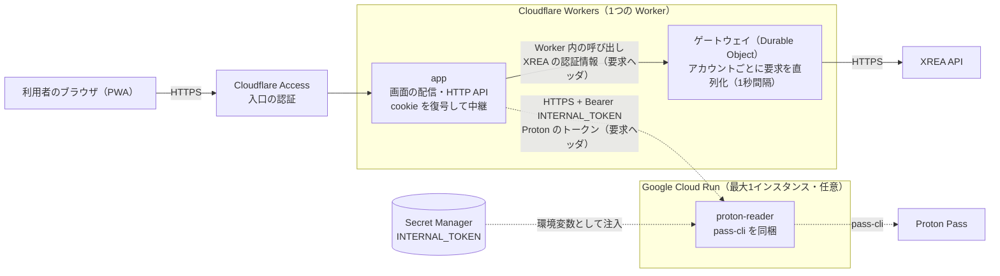
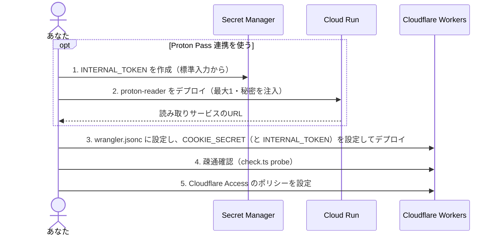

# クラウドへの配備

アプリ（`app`）を Cloudflare Workers の無料枠へ配備する手順です。XREAゲートウェイは `app` と同じ Worker の Durable Object として動くため、ゲートウェイ用のコンテナは要りません。コンテナ基盤が要るのは、任意の Proton Pass 読み取りサービスを使うときだけです。

この文書では具体例として Google Cloud Run の手順を示します（読み取りサービスを使うときのみ）。配備は手元の端末から手動で実行します。

## 構成



実線は必須の経路、点線は任意（Proton Pass 連携）または設定の経路です。

| コンポーネント  | 動かす場所                         | 状態                                                           | 備考                                                                                   |
| --------------- | ---------------------------------- | -------------------------------------------------------------- | -------------------------------------------------------------------------------------- |
| `app`           | Cloudflare Workers                 | なし。認証情報は暗号化した cookie に入り、サーバには保存しない | 秘密は `COOKIE_SECRET`（読み取りサービスを使うときは `INTERNAL_TOKEN` も）             |
| ゲートウェイ    | 同じ Worker の Durable Object      | メモリのみ（一覧のキャッシュ。永続ストレージには何も書かない） | アカウントごとに1つ。XREAの1秒間隔の制限を、台数に依らず守る                           |
| `proton-reader` | コンテナ（任意）                   | セッションのみ（一時領域でよい）                               | 使わなければ配備せず、`PROTON_READER_URL` を空にする。**最大1インスタンス**            |

通信に載るのは、認証情報（要求ヘッダ）と、アドレスとエントリ名の対応表だけです。Proton Pass のパスワードは応答にもログにも出ません。

### 配備の順序

読み取りサービスのURLは配備後に決まるため、コンテナ → Workers の順に進めます。読み取りサービスを使わないときは、Workers だけを配備します。



## 事前準備（クイックスタートと配備手順に共通）

### 手元の環境

作業端末に次が揃っていることを、どちらの手順に入る前にも確認してください。Google Cloud・gcloud・Docker・openssl は、Proton Pass 読み取りサービスを配備するときだけ必要です（使わなければ Cloudflare と Node.js だけで足ります）。

| 項目                         | 内容                                                                                                                                     | 確認                                  |
| ---------------------------- | ---------------------------------------------------------------------------------------------------------------------------------------- | ------------------------------------- |
| Google Cloud アカウント（読み取りサービスを使うとき） | プロジェクトを作成し、**課金を有効化**する（Cloud Run・Artifact Registry・Secret Manager に必要。無料枠内でも課金アカウントの紐付けは必須） | <https://console.cloud.google.com/>   |
| gcloud CLI                   | インストール手順: <https://cloud.google.com/sdk/docs/install>（Ubuntu/Debian は apt でも導入可: <https://cloud.google.com/sdk/docs/install#deb>） | `gcloud --version`                    |
| gcloud の認証と初期設定      | インストール後に `gcloud init`（または `gcloud auth login`）を実行する。初期設定の手順: <https://cloud.google.com/sdk/docs/initializing>   | `gcloud auth list`                    |
| Docker                       | コンテナのイメージをビルド・push する。インストール手順（Ubuntu）: <https://docs.docker.com/engine/install/ubuntu/>。実行ユーザーが `docker` グループに属していること | `docker version`                      |
| Node.js と npm               | `package.json` の要件に合う版。wrangler は `npx` で都度取得されるため、別途の導入は不要                                                  | `node --version`、`npm --version`     |
| Cloudflare アカウント        | Workers の無料枠を使う。登録: <https://dash.cloudflare.com/sign-up>。wrangler の説明: <https://developers.cloudflare.com/workers/wrangler/install-and-update/> | -                                     |
| wrangler のログイン          | `npx wrangler login` を実行し、ブラウザで認可する（ブラウザのない環境では API トークンを `CLOUDFLARE_API_TOKEN` に設定する: <https://developers.cloudflare.com/fundamentals/api/get-started/create-token/>） | `npx wrangler whoami`                 |
| Cloudflare Zero Trust（Access） | 「配備後の作業」の入口の保護に使う。初回は Zero Trust の組織名の設定が必要（無料プランで足りる）: <https://developers.cloudflare.com/cloudflare-one/> | ダッシュボードで Zero Trust が開ける  |
| direnv（任意）               | ディレクトリに入ると `.envrc` を自動で読み込む。インストール手順: <https://direnv.net/docs/installation.html>。シェルへのフック設定も必要: <https://direnv.net/docs/hook.html>。使わなければ `source .envrc` で代用できる | `direnv version`                      |
| openssl                      | 共有シークレットの生成に使う                                                                                                             | `openssl version`                     |
| 利用するリージョン           | 例は `asia-northeast1`（東京）。変えるときは環境変数 `REGION` を合わせる                                                              | -                                     |

gcloud と Docker の設定・認証情報は、リポジトリ直下の `.gcloud/`、`.docker/`（どちらも gitignore 済み）に閉じます。[.envrc](../.envrc) が `CLOUDSDK_CONFIG` と `DOCKER_CONFIG` を設定するため、direnv を使うならこのディレクトリに入るだけで有効になります（初回は `direnv allow`）。direnv を使わない場合は、シェルごとに `source .envrc` を実行してください。

```sh
npx wrangler login
# 読み取りサービスを使うときだけ（Google Cloud の認証とプロジェクト）
gcloud auth login
export PROJECT_ID=<プロジェクトID>
export REGION=asia-northeast1
gcloud config set project "$PROJECT_ID"

npx wrangler whoami        # 所属するアカウントの名前とIDが表示される
export CLOUDFLARE_ACCOUNT_ID=<使うアカウントのID>
```

アカウントIDは秘匿値ではありませんが、`wrangler.jsonc` には書かず環境変数で渡します。

作業の前に、リポジトリで `npm ci` と `npm test` が通ることも確認しておくと、配備後の不具合の切り分けが楽になります。

### 決める値

これらの値はクイックスタートでは自動作成します。

| 項目                  | 内容                                                                                                              |
| --------------------- | ----------------------------------------------------------------------------------------------------------------- |
| COOKIE_SECRET         | 認証情報を暗号化する鍵の元。32文字以上。Workers だけが持つ                                                        |
| INTERNAL_TOKEN        | Workers と読み取りサービスの共有シークレット。32文字以上。読み取りサービスを使うときだけ必要                      |
| 読み取りサービスのURL | 読み取りサービスの配備で公開されるHTTPSのURL（配備後に決まる）。Proton Pass 連携を使わないなら不要                |

秘匿値（COOKIE_SECRET と、使う場合の INTERNAL_TOKEN）は、リポジトリ・チャット・シェルの履歴・ログに残さないでください。どちらの手順も、値をコマンドの引数に書かず、標準入力で渡す形にしています。

## クイックスタート

構成例の環境を一括で配備するコマンドは以下です。Proton Pass 連携を使わない場合は、Cloudflare だけで完結します（Google Cloud は使いません）。

```sh
npm ci
npm run deploy:cloud -- --no-reader
```

Proton Pass 連携も使うときは、読み取りサービス（`proton-reader`）を Cloud Run に配備します。このとき `PROJECT_ID` が必要です。

```sh
npm run deploy:cloud
```

変更を伴う操作を実行せず、実行される内容だけを確認するときは `--dry-run` を付けます（読み取りだけは実行するため、読み取りサービスを含むときは gcloud の認証が必要です）。

```sh
npm run deploy:cloud -- --dry-run
```

### 設定

| 環境変数                | 必須                               | 既定値            | 内容                                                                                           |
| ----------------------- | ---------------------------------- | ----------------- | ---------------------------------------------------------------------------------------------- |
| `CLOUDFLARE_ACCOUNT_ID` | 必須                               |                   | Cloudflare のアカウントID                                                                      |
| `PROJECT_ID`            | 読み取りサービスを配備するときのみ |                   | Google Cloud のプロジェクトID                                                                  |
| `REGION`                | 任意                               | `asia-northeast1` | Cloud Run と Artifact Registry のリージョン                                                    |
| `IMAGE_TAG`             | 任意                               | `v1`              | コンテナイメージのタグ。更新のたびに変えず、同じタグで入れ直す                                 |
| `APP_URL`               | 任意                               |                   | app のURL。指定すると配備の最後に疎通確認を実行する。省くと、確認用のコマンドを表示して終える |

### 実行される内容

スクリプトは、何度実行しても同じ結果になります。既にあるものは作り直さず、コンテナだけを同じタグで入れ直します。

| 順 | 対象                | 内容                                                                                                                                                                                   |
| -- | ------------------- | -------------------------------------------------------------------------------------------------------------------------------------------------------------------------------------- |
| 1  | Google Cloud の準備 | API の有効化、Artifact Registry のリポジトリ `xrea`、Secret Manager の `xrea-internal-token`（無ければ標準入力で作成。あれば変更しない）。`--no-reader` のときは行わない                |
| 2  | `proton-reader`     | イメージをビルド → 既存の Cloud Run サービスを削除 → 既存のイメージ（同じタグ）を削除 → push → 最大インスタンス数1でデプロイ（`--no-reader` のときは行わない）                         |
| 3  | `app`               | ビルド → 読み取りサービスを配備したときだけ `INTERNAL_TOKEN` を Secret Manager から取り出して設定 → `COOKIE_SECRET` は未設定のときだけ新規に作成 → 読み取りサービスのURLを渡してデプロイ |
| 4  | 疎通確認            | `APP_URL` があれば `check.ts probe` を実行する                                                                                                                                         |

- 時間のかかるビルドを先に済ませてから削除するため、読み取りサービスが止まる時間は push とデプロイの間だけです。再実行のあいだ、そのコンテナへの要求は失敗します（照合の状態がエラーになるだけで、一覧は返ります）。
- ゲートウェイは Worker の一部なので、Worker を配備すると同時に更新されます。Durable Object の移行（`migrations`）は、初回の配備で自動的に適用されます。
- Cloud Run のサービスのURLは、削除して作り直しても変わりません。
- `COOKIE_SECRET` は、設定済みなら変更しません。変更すると登録済みの認証情報がすべて失効するためです。初回に作られた値は Workers から読み戻せないので、[クラウドの運用](cloud-operations.md)に従って控えてください。
- URL は `wrangler deploy --var` で渡すため、`wrangler.jsonc` を書き換えません。定義は、`wrangler.jsonc` があればそれを、無ければ雛形 `wrangler.template.jsonc` を使います。自分のドメインへ配信するときは、先に `wrangler.jsonc` に `routes` を書いてください（[配備手順](#配備手順)の「Cloudflare Workers の手順」を参照）。
- 入口の保護（Cloudflare Access）は含みません。「配備後の作業」で設定してください。

### コンテナ基盤に求める条件（読み取りサービス）

| 条件               | 読み取りサービス                               |
| ------------------ | ---------------------------------------------- |
| イメージ           | `--target reader`                              |
| コマンド           | 既定（`node /app/dist/reader/main.js`）        |
| 環境変数           | `INTERNAL_TOKEN`。`PORT` は基盤が与える値を使う（`SESSION_DIR` は既定のままでよい） |
| 最大インスタンス数 | 1                                              |
| 公開               | HTTPS（Workers から呼び出せること）            |
| 永続ボリューム     | 不要（失われても次の要求で自動的に再ログイン） |
| 死活確認           | `GET /health` が 200                           |

共有シークレットを知らない呼び出し元は 401 で拒否されます。

## 配備手順

クイックスタートと同じ構成を、1手順ずつ実行します。事前準備を終えていることが前提です。

### Google Cloud Run の手順（Proton Pass 読み取りサービス・任意）

使わない場合はこの手順を飛ばし、Workers の手順の `PROTON_READER_URL` を空のままにします。Proton Pass 連携は無効になり、読み取りサービスの呼び出しも発生しません。

#### 準備

gcloud と Docker の認証・プロジェクトは、事前準備で設定した状態を使います。

```sh
gcloud services enable run.googleapis.com artifactregistry.googleapis.com secretmanager.googleapis.com

gcloud artifacts repositories create xrea --repository-format=docker --location="$REGION"
gcloud auth configure-docker "$REGION-docker.pkg.dev"
```

共有シークレットを Secret Manager に作ります。値は標準入力で渡すため、画面にもシェルの履歴にも残りません。

```sh
openssl rand -base64 48 | tr -d '\n' | gcloud secrets create xrea-internal-token --data-file=-

# Cloud Run の実行用サービスアカウントに読み取りを許可する（既定はCompute Engineの既定アカウント）
PROJECT_NUMBER=$(gcloud projects describe "$PROJECT_ID" --format='value(projectNumber)')
gcloud secrets add-iam-policy-binding xrea-internal-token \
  --member="serviceAccount:${PROJECT_NUMBER}-compute@developer.gserviceaccount.com" \
  --role=roles/secretmanager.secretAccessor
```

Workers にも同じ値を渡す必要があります。Workers の手順で、Secret Manager から取り出して `wrangler secret put` へ標準入力で渡します。

#### ビルドとデプロイ

Cloud Run は amd64 で動くため、Apple Silicon などでは `--platform linux/amd64` を付けます。

```sh
IMAGE_READER="$REGION-docker.pkg.dev/$PROJECT_ID/xrea/reader:v1"
docker build --platform linux/amd64 --target reader -t "$IMAGE_READER" .
docker push "$IMAGE_READER"

gcloud run deploy proton-reader \
  --image "$IMAGE_READER" --region "$REGION" \
  --max-instances 1 --min-instances 0 \
  --allow-unauthenticated \
  --set-secrets INTERNAL_TOKEN=xrea-internal-token:latest

export READER_URL=$(gcloud run services describe proton-reader --region "$REGION" --format='value(status.url)')
echo "$READER_URL"
```

| 指定                      | 理由                                                                                                  |
| ------------------------- | ----------------------------------------------------------------------------------------------------- |
| `--max-instances 1`       | Proton Pass のセッションを1つのプロセスで持つため                                                     |
| `--min-instances 0`       | 常駐させない。アイドル後の最初の要求だけ、起動の待ちが入る                                            |
| `--allow-unauthenticated` | Workers は Google の ID トークンを持たないため。呼び出しの認可は `INTERNAL_TOKEN`（401 で拒否）が担う |
| `--set-secrets`           | 秘匿値をデプロイの定義に書かず、Secret Manager から環境変数として注入する                             |
| `PORT` を指定しない       | Cloud Run が設定する予約の変数。アプリはその値で待ち受ける                                            |

セッションの保存先（`SESSION_DIR`）は既定のままで構いません。Cloud Run のファイルシステムは一時領域で、再起動で失われても、次の要求で読み取りサービスが自動的に再ログインします。

### Cloudflare Workers の手順（app）

```sh
npm ci
npm run build:worker && npm run build:web
```

配備の定義は、リポジトリの雛形 `wrangler.template.jsonc` を複製した `wrangler.jsonc`（gitignore 済み。自分のURLやドメインを書く個人用）に書きます。

```sh
cp wrangler.template.jsonc wrangler.jsonc
```

ゲートウェイは Durable Object として定義済みです（`durable_objects` の束縛 `GATEWAY` と、`migrations` の SQLite 方式のクラス）。`wrangler.jsonc` の `vars` には、読み取りサービスを使うときだけURLを書きます（URLは秘匿値ではないため定義に置きます）。

```jsonc
"vars": {
  "PROTON_READER_URL": "",   // 使うときは読み取りサービスのURL。使わないなら空のまま
  "CREDENTIAL_STORE": "cookie"
}
```

自分のドメインへ配信するときは、`wrangler.jsonc` に `routes` を足します。ドメインのゾーンが同じ Cloudflare アカウントの DNS にあることが前提で、DNS レコードと証明書は自動で作られます。

```jsonc
"routes": [{ "pattern": "app.example.com", "custom_domain": true }],
```

Cloudflare のアカウントは、事前準備で設定した `CLOUDFLARE_ACCOUNT_ID` を使います。

秘密を設定します。`COOKIE_SECRET` は新しく作って渡します（Workers だけが持ち、ほかのコンポーネントとは共有しません）。読み取りサービスを使うときは、`INTERNAL_TOKEN` も Secret Manager から取り出して標準入力で渡します（画面に出ません）。

```sh
openssl rand -base64 48 | tr -d '\n' | npx wrangler secret put COOKIE_SECRET
# 読み取りサービスを使うときだけ
gcloud secrets versions access latest --secret=xrea-internal-token | npx wrangler secret put INTERNAL_TOKEN
npx wrangler deploy
```

`COOKIE_SECRET` を変更すると、登録済みの認証情報はすべて復号できなくなり、利用者は再登録が必要になります。Workers の秘密は読み戻せないため、値は Secret Manager などに控えてください。再登録なしで更新する手順（`COOKIE_SECRET_PREVIOUS`）は[クラウドの運用](cloud-operations.md)を参照してください。

Workers は `PROTON_READER_URL` に https 以外を受け付けません（http だと 500 になり、ログに変数名が出ます）。Workers は SQLite 方式の認証情報の保持を使えません（`CREDENTIAL_STORE=cookie` のままにします）。無料枠の上限は、1要求あたり CPU 10ミリ秒、1日 10万要求、スクリプト 3MB（圧縮後）です。このアプリは圧縮後 1MB 以下で、一覧の要求の CPU 時間は 10ミリ秒を下回ります。ゲートウェイの Durable Object は SQLite 方式で作られ、無料枠で使えます（永続ストレージには何も書きません）。

## 配備後の作業

以降は、クイックスタートでも配備手順でも共通です。

### 疎通確認

クイックスタートで `APP_URL` を指定した場合は、配備の最後に実行済みです。

```sh
npx tsx scripts/cloud/check.ts probe \
  --app https://app.example.net \
  --reader "$READER_URL"   # 使わないなら省く
```

60秒以内に次を確認し、成功と失敗の別だけを表示します（秘匿値は表示しません）。

| 検査                                       | 失敗したときの原因                                                                                                              |
| ------------------------------------------ | ------------------------------------------------------------------------------------------------------------------------------- |
| Workers・読み取りサービスの死活確認        | URL、公開設定、コンテナの起動。Cloud Run では `--allow-unauthenticated` の付け忘れ（403）も確認                                 |
| 共有シークレットなしの要求が 401（読み取りサービス） | `INTERNAL_TOKEN` が未設定                                                                                     |
| 誤った認証情報の登録が 400 になる          | 内蔵ゲートウェイ（Durable Object）が XREA へ到達できていない（502 になる）。`GATEWAY` の束縛と `migrations` の定義を確認する |

入口の保護で Cloudflare Access を先に有効にしている場合、コマンドラインからの疎通確認は Access のログインへ 302 で転送されて失敗します。疎通確認は Access を有効にする前に実施するか、Access のサービストークンを使ってください。

読み取りサービスのコンテナ基盤の設定が要件を満たすかは、次で検査できます。

```sh
npx tsx scripts/cloud/check.ts platform --max-instances 1 --https true --internal-token true
```

Cloud Run の最大インスタンス数は、次で確認できます。

```sh
gcloud run services describe proton-reader --region "$REGION" \
  --format='value(spec.template.metadata.annotations["autoscaling.knative.dev/maxScale"])'
```

### 入口の保護

Workers の前段の Cloudflare Access の設定は、このリポジトリの対象外です。公開前に、自分だけが入れるポリシーを設定してください。

### 更新と撤去

| 操作                   | 手順                                                                                                                        |
| ---------------------- | --------------------------------------------------------------------------------------------------------------------------- |
| 全体の更新             | `npm run deploy:cloud` を再実行する（読み取りサービスのコンテナは同じタグのまま入れ直される。ゲートウェイは Worker と一緒に更新される） |
| コンテナの更新（手動） | イメージのタグ（`v2` など）を変えてビルド・push し、`gcloud run deploy` の `--image` を差し替える。同じタグで入れ直すときは、サービスとイメージを先に `gcloud run services delete`、`gcloud artifacts docker images delete IMAGE --delete-tags` で削除する |
| Workers の更新         | `npm run build:worker && npm run build:web && npx wrangler deploy`                                                          |
| 共有シークレットの更新 | `gcloud secrets versions add` で新しい版を追加し、読み取りサービスを再デプロイして、Workers の `INTERNAL_TOKEN` も更新（読み取りサービスを使うときのみ） |
| 撤去                   | `npm run destroy:cloud`（下記）。手動では `npx wrangler delete`、`gcloud run services delete proton-reader`、`gcloud artifacts repositories delete xrea`、`gcloud secrets delete xrea-internal-token`、`gcloud secrets delete xrea-cookie-secret` |

#### 一括で撤去する

本アプリが扱う情報を Cloud Run と Cloudflare に残さないよう、構成例のすべてを削除します。**元に戻せません。Workers を削除すると、登録済みの認証情報（暗号化 cookie の鍵 `COOKIE_SECRET`）も失われ、利用者は再登録が必要になります。**

```sh
npm run destroy:cloud             # PROJECT_ID の入力で確認してから削除する
npm run destroy:cloud -- --yes    # 確認を省く（非対話の実行ではこちらが必須）
npm run destroy:cloud -- --dry-run
npm run destroy:cloud -- --workers-only    # Workers だけを削除する（PROJECT_ID が不要）
```

必要な環境変数は `CLOUDFLARE_ACCOUNT_ID` と `PROJECT_ID`（任意で `REGION`）です。`PROJECT_ID` が未設定なら、何も削除せず起動直後に止まります。Google Cloud に触れず Workers だけを削除するときは `--workers-only` を付けます。すべての `gcloud` は `PROJECT_ID` のプロジェクトへ向けて実行し、`gcloud config` の既定のプロジェクトには依存しません。何度実行しても同じ結果になり、存在しないものは飛ばします。次の順に削除します。

| 順 | 対象                                  | 内容                                                                                     |
| -- | ------------------------------------- | ---------------------------------------------------------------------------------------- |
| 1  | app（Workers）                        | スクリプト、画面ファイル、ゲートウェイの Durable Object、Workers の秘密（`COOKIE_SECRET`、`INTERNAL_TOKEN`） |
| 2  | `proton-reader`                       | Cloud Run のサービス（Proton Pass のセッションを持つ一時領域も、サービスとともに失われる） |
| 3  | Artifact Registry の `xrea`           | リポジトリごと、すべてのイメージ                                                         |
| 4  | Secret Manager                        | `xrea-internal-token`、`xrea-cookie-secret`（運用手順で作った控え）                      |
| 5  | 手元                                  | ビルドした Docker イメージ                                                               |

次は削除の対象外なので、必要なら手動で確認してください。

- Cloud Run のログ（Cloud Logging）。保持期間（既定30日）まで残ります。ログには要求の記録だけが残り、秘匿値と認証情報は含まれません。
- Cloudflare Access のポリシー、カスタムドメインの DNS レコード（Workers の削除で外れない場合）。
- 有効化した Google Cloud の API。データは持ちません。
- `.gcloud/`、`.docker/`、`wrangler.jsonc` など手元の設定。
